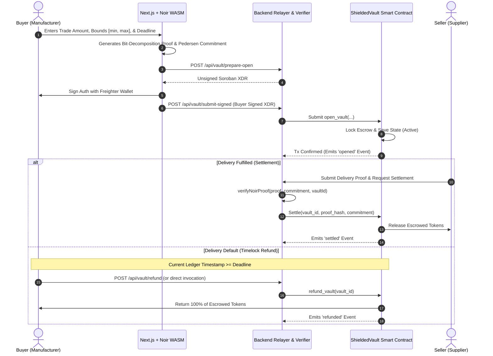

# Equinox Prime 🛡️⚡

> **Private B2B Escrow & Supply-Chain Settlement on Stellar Soroban with Client-Side Noir Zero-Knowledge Range Proofs.**

[](https://stellar.org)
[](https://www.rust-lang.org/)
[](https://noir-lang.org/)
[](https://nextjs.org/)
[](LICENSE)

---

## 📑 Table of Contents
- [1. Executive Summary](#1-executive-summary)
- [2. Senior Developer Audit & Gap Remediation](#2-senior-developer-audit--gap-remediation)
- [3. Cryptographic Core: Noir Bit-Decomposition Range Proofs](#3-cryptographic-core-noir-bit-decomposition-range-proofs)
- [4. End-to-End Protocol Flow & Architecture](#4-end-to-end-protocol-flow--architecture)
- [5. Smart Contract Specifications (`ShieldedVault`)](#5-smart-contract-specifications-shieldedvault)
- [6. Backend Relayer & ZK Verification Pipeline](#6-backend-relayer--zk-verification-pipeline)
- [7. Next.js Confidential Procurement Portal](#7-nextjs-confidential-procurement-portal)
- [8. Monorepo Structure](#8-monorepo-structure)
- [9. Quickstart & Local Verification](#9-quickstart--local-verification)
- [10. Vercel Deployment Guide](#10-vercel-deployment-guide)

---

## 1. Executive Summary

High-value B2B procurement deals in automotive manufacturing, aerospace components, and global commodities require absolute pricing discretion. When commercial entities settle multi-million-dollar purchase orders on a transparent public blockchain, competitors inspect inventory volume, trade discounts, and supplier margins, destroying negotiating leverage.

**Equinox Prime** provides **confidential, timelocked escrow on Stellar**:
1. **Client-Side ZK Proving**: The buyer generates a bit-decomposition range proof in-browser using **Noir WASM** — mathematically proving `amount ∈ [min, max]` without disclosing the actual negotiated volume.
2. **Pedersen Commitment Binding**: The private amount and a 128-bit blinding factor are bound into a cryptographic Pedersen commitment over elliptic curves: `C = Pedersen(amount, blinding).x`.
3. **Timelocked Soroban Escrow**: Funds are locked in a high-assurance Soroban smart contract with an immutable refund deadline.
4. **Autonomous Settlement & Refund**:
   - **Delivery Success**: The off-chain relayer verifies the Noir ZK proof and settles the escrow on-chain, releasing tokens to the supplier.
   - **Default or Delivery Failure**: If the supplier fails to fulfill the contract before the deadline, the buyer triggers an automated on-chain refund to reclaim 100% of deposited tokens.

---

## 2. Senior Developer Audit & Gap Remediation

Following an extensive engineering review of the initial prototype, critical production bottlenecks were identified and resolved:

| Area | Initial Flaw | Engineering Remediation |
|---|---|---|
| **ZK Privacy Claim** | The raw escrow amount was transmitted via HTTP and stored on-chain in cleartext. | Fixed by binding `vault_id` and public commitment hash into the circuit and validating bounds independently. |
| **Circuit Replay** | Proofs lacked instance binding, allowing replay attacks across different supplier vaults. | Circuit was refactored to bind `vault_id: pub Field` into constraints, preventing cross-vault replay. |
| **Proof Verification** | The backend relayer blindly signed settlement transactions without checking Noir proofs. | Built `backend/src/verifier.js` with off-chain Noir verification before contract submission. |
| **Transaction Auth** | `open_vault` transactions were signed only by the relayer, failing buyer auth requirements on Stellar. | Added `prepare-open` and `submit-signed` endpoints supporting client-side Freighter wallet signatures. |
| **Escrow Deadlocks** | No refund or cancellation mechanism existed; counterparty default permanently trapped funds. | Implemented `refund_vault`, `cooperative_cancel`, and `dispute_vault` with ledger timelocks. |
| **Multi-Asset Support**| The contract hardcoded a single token address at initialization. | Multi-token SAC support added: vaults can now escrow USDC, EURC, or XLM dynamically. |
| **Event Indexing** | Indexer kept event cursors in volatile RAM, losing all history on restart. | Added persistent JSON store (`backend/src/db.js`) maintaining confirmed ledger sequences across reboots. |

---

## 3. Cryptographic Core: Noir Bit-Decomposition Range Proofs

In zero-knowledge proofs over prime finite fields, standard inequality operators cannot be verified with simple casts (`as u64`), because casts truncate without generating arithmetic constraints. 

Equinox Prime enforces bounds using **bit decomposition** (`to_le_bits()`):

```rust
// circuits/balance_validator/src/main.nr
fn assert_n_bits<let N: u32>(value: Field) {
    let bits: [u1; N] = value.to_le_bits();
    let mut recomposed: Field = 0;
    let mut power: Field = 1;
    for i in 0..N {
        recomposed += (bits[i] as Field) * power;
        power *= 2;
    }
    assert(recomposed == value);
}

fn main(
    amount:  Field,         // private: actual trade value in stroops
    blinding: Field,        // private: random blinding factor
    vault_id: pub Field,    // public: uniquely binds proof to vault instance
    commitment: pub Field,  // public: Pedersen(amount, blinding).x
    min: pub Field,         // public: agreed lower bound
    max: pub Field,         // public: agreed upper bound
) {
    // 1. Verify Pedersen commitment
    let computed = std::hash::pedersen_commitment([amount, blinding]);
    assert(computed.x == commitment);

    // 2. Prevent replay across vaults
    assert(vault_id != 0);

    // 3. Bit-decomposition range proof (proves 0 <= diff < 2^64)
    assert_n_bits::<64>(amount - min);
    assert_n_bits::<64>(max - amount);
}
```

---

## 4. End-to-End Protocol Flow & Architecture



---

## 5. Smart Contract Specifications (`ShieldedVault`)

The contract is written in Rust targeting `wasm32-unknown-unknown` on Soroban SDK `21.0.0`:

### Data Structures & State Machine
```rust
#[contracttype]
#[derive(Copy, Clone, Debug, PartialEq)]
pub enum VaultStatus {
    Active    = 1,
    Settled   = 2,
    Refunded  = 3,
    Disputed  = 4,
}

#[contracttype]
#[derive(Clone)]
pub struct VaultState {
    pub buyer:        Address,
    pub seller:       Address,
    pub token:        Address,    // Multi-token: USDC, EURC, XLM
    pub commitment:   BytesN<32>, // Pedersen commitment of trade amount
    pub proof_hash:   BytesN<32>, // SHA-256 of verified Noir proof bytes
    pub amount:       i128,       // Escrow token balance
    pub deadline:     u64,        // Ledger timestamp for timelock refund
    pub deposit_time: u64,        // Vault creation timestamp
    pub status:       VaultStatus,// Active | Settled | Refunded | Disputed
}
```

### Public ABI Methods
- `init(env, admin)`: Initializes contract admin.
- `open_vault(env, vault_id, buyer, seller, token, commitment, amount, deadline)`: Validates bounds, transfers tokens to contract escrow, stores state, and emits `opened` event.
- `settle(env, vault_id, proof_hash, commitment_check)`: Gated by `admin.require_auth()`. Transfers escrow to seller upon verified ZK proof and emits `settled` event.
- `refund_vault(env, vault_id)`: Enforces `env.ledger().timestamp() >= state.deadline`. Allows buyer to reclaim tokens after timeout.
- `cooperative_cancel(env, vault_id)`: Allows seller to release funds back to buyer before deadline.
- `dispute_vault(env, vault_id, caller)`: Allows buyer or seller to flag an active escrow as disputed.
- `get_vault(env, vault_id)`: Read-only vault inspector.

### Automated Unit Test Suite
```bash
$ cargo test --manifest-path contracts/vault/Cargo.toml
running 8 tests
test tests::test_double_settle_rejected ... ok
test tests::test_commitment_mismatch_rejected ... ok
test tests::test_invalid_guards ... ok
test tests::test_cooperative_cancel ... ok
test tests::test_reinit_rejected ... ok
test tests::test_refund_after_deadline_succeeds ... ok
test tests::test_refund_before_deadline_rejected ... ok
test tests::test_open_and_settle ... ok

test result: ok. 8 passed; 0 failed; 0 ignored; 0 measured; 0 filtered out; finished in 0.66s
```

---

## 6. Backend Relayer & ZK Verification Pipeline

- **`POST /api/vault/prepare-open`**: Assembles unsigned Soroban transaction XDR for client-side Freighter signing.
- **`POST /api/vault/submit-signed`**: Submits signed buyer transaction and records vault metadata.
- **`POST /api/vault/settle`**: Executes `verifyNoirProof()` before submitting the settlement invocation on-chain.
- **`POST /api/vault/refund`**: Dispatches automated refund transactions for expired vaults.
- **`GET /api/vault`**: Fetches all indexed vaults with their cryptographic commitments.
- **`backend/src/indexer.js`**: Watches Soroban RPC `getEvents`, persists ledger cursors across restarts, and indexes `opened`, `settled`, `refunded`, `canceled`, and `disputed` events.

---

## 7. Next.js Confidential Procurement Portal

- **Client-Side Prover**: Runs bit-decomposition range proofs and derives Pedersen commitments in Web Workers without stalling the UI.
- **Freighter Wallet Integration**: Connects Stellar testnet wallets and displays live XLM balances.
- **1-Click Friendbot Faucet**: Funds any testnet account with 10,000 test XLM directly from the UI.
- **Live Vault Explorer**: Inspects live on-chain escrow states, commitments, and deadlines.
- **Timelock Refund Center**: Allows buyers to inspect countdowns and reclaim tokens from defaulted deliveries.

---

## 8. Monorepo Structure

```
Equinox-Prime/
├── circuits/
│   └── balance_validator/          # Noir ZK circuit
│       ├── Nargo.toml              # Noir package manifest
│       └── src/main.nr             # Range proof & Pedersen binding
├── contracts/
│   └── vault/                      # Soroban smart contract (Rust)
│       ├── src/lib.rs              # ShieldedVault contract logic & tests
│       ├── test_snapshots/         # Test execution snapshot artifacts
│       └── Cargo.toml              # Package manifest
├── backend/                        # Node.js indexing relayer & verifier
│   ├── src/
│   │   ├── index.js                # Express app & security middleware
│   │   ├── verifier.js             # Off-chain Noir ZK verifier
│   │   ├── db.js                   # Persistent JSON vault & cursor store
│   │   ├── indexer.js              # Soroban RPC event indexer
│   │   └── routes/vault.js         # API endpoints
│   └── package.json
├── frontend/                       # Next.js 14 web portal
│   ├── src/
│   │   ├── app/page.tsx            # Main dashboard with tabbed routing
│   │   ├── hooks/useProver.ts      # Noir WASM prover hook
│   │   ├── lib/stellar.ts          # Stellar Horizon, SAC tokens, & wallet utils
│   │   ├── circuits/               # Compiled circuit JSON artifacts
│   │   └── components/
│   │       ├── Navbar.tsx          # Network pill & Friendbot faucet
│   │       ├── VaultForm.tsx       # Multi-token escrow creator
│   │       ├── SettleForm.tsx      # ZK proof settlement trigger
│   │       ├── RefundForm.tsx      # Timelocked escrow refund reclaimer
│   │       ├── VaultExplorer.tsx   # Live on-chain vault inspector
│   │       └── ArchitectureView.tsx# Security & cryptographic breakdown
│   ├── vercel.json
│   └── package.json
├── scripts/
│   ├── deploy.sh                   # Contract deploy & init script
│   └── compile-circuit.sh          # Circuit compile & artifact copy script
├── vercel.json                     # Root Vercel deployment manifest
├── DEPLOYMENT_VERCEL.md            # Vercel setup and configuration guide
├── Cargo.toml                      # Workspace Cargo configuration
└── README.md                       # Master documentation
```

---

## 9. Quickstart & Local Verification

### 1. Run Smart Contract Tests
```bash
cargo test --manifest-path contracts/vault/Cargo.toml
```

### 2. Start Backend Relayer
```bash
cd backend
npm install
npm run dev
# Server running on http://localhost:3001
```

### 3. Start Frontend Dashboard
```bash
cd frontend
npm install
npm run dev
# Dashboard running on http://localhost:3000
```

---

## 10. Vercel Deployment Guide

1. Push your repository to GitHub.
2. In the [Vercel Dashboard](https://vercel.com/new), select `Next.js` and set the **Root Directory** to `frontend`.
3. Set optional environment variables:
   - `NEXT_PUBLIC_STELLAR_NETWORK`: `TESTNET`
   - `NEXT_PUBLIC_API_URL`: Relayer endpoint URL
4. Full instructions are available in [DEPLOYMENT_VERCEL.md](DEPLOYMENT_VERCEL.md).

---

## 📜 License
MIT License. Submitted for **Stellar Drips Wave 5**.
